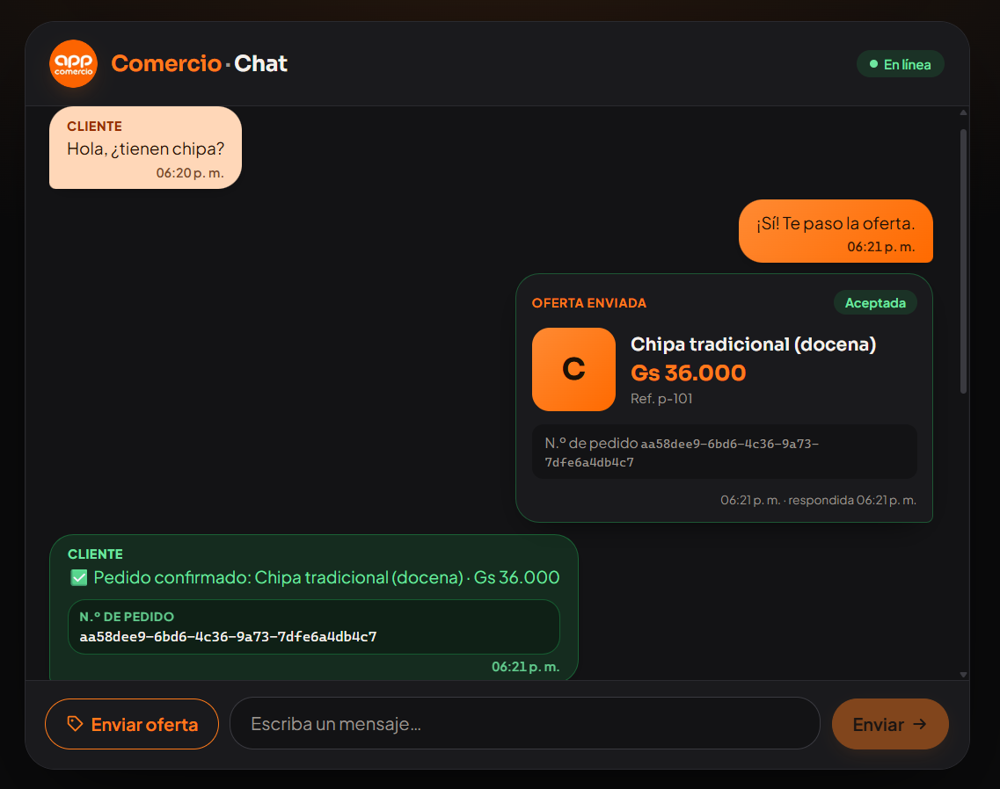
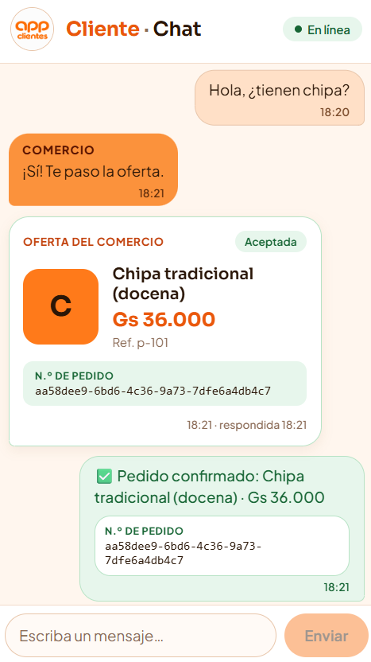
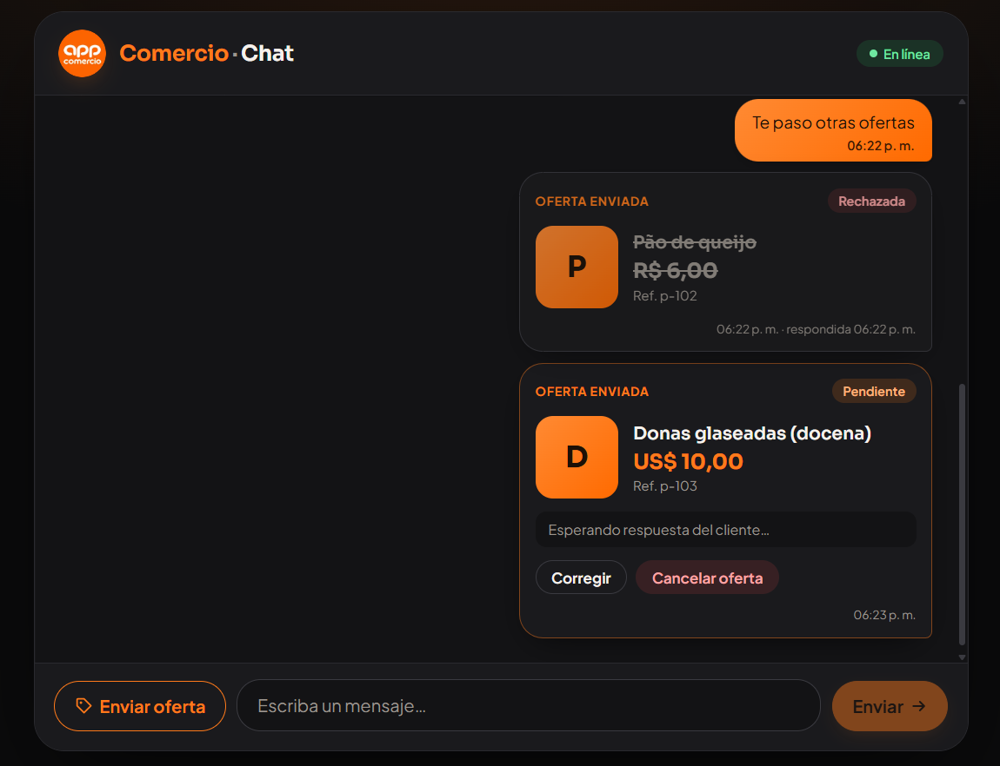
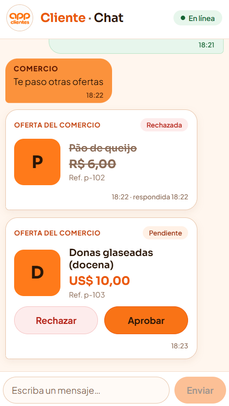
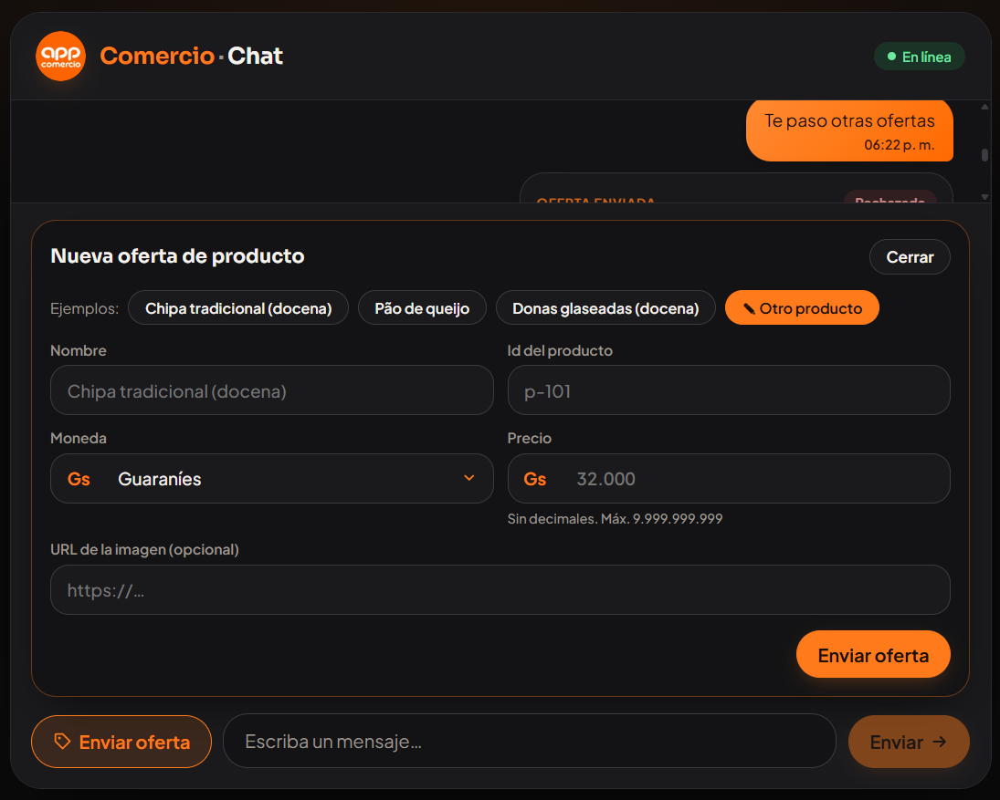

# Chat de producto en tiempo real

Chat entre un **cliente móvil** (React Native · Expo) y un **comercio web** (React · Vite) sobre **Firebase Realtime Database**. En cualquier momento de la conversación el comercio puede enviar una **oferta de producto**; el cliente la **aprueba o rechaza** y, al aprobarla, el pedido se guarda en una **API NestJS**.

```
┌──────────────────┐   mensajes y ofertas   ┌─────────────────────────┐   mensajes y ofertas   ┌──────────────────┐
│  Comercio web    │ ─────────────────────▶ │ Firebase Realtime DB    │ ◀───────────────────── │  Cliente móvil   │
│  React + Vite    │ ◀───── listener ────── │ /chats/{chatId}/messages│ ────── listener ─────▶ │  React Native    │
└──────────────────┘                        └─────────────────────────┘                        └────────┬─────────┘
                                                                                                         │ POST /orders
                                                                                                         ▼    (al aprobar)
                                                                                                ┌──────────────────┐
                                                                                                │  API NestJS      │
                                                                                                │  orders.json     │
                                                                                                └──────────────────┘
```

## Capturas

| Comercio web | Cliente móvil |
| :----------: | :-----------: |
|  |  |
| Oferta aceptada y confirmación con el N.º de pedido | Aprobación de la oferta y confirmación en el chat |
|  |  |
| Estados de las ofertas; Corregir y Cancelar mientras está pendiente | Aprobar y Rechazar solo en ofertas pendientes |

<p align="center">
  <br>
  <sub>Formulario de oferta: productos de ejemplo, “Otro producto”, selector de moneda y precio con formato.</sub>
</p>

## Contenido

1. [Estructura](#estructura)
2. [Requisitos](#requisitos)
3. [Firebase](#firebase)
4. [Variables de entorno](#variables-de-entorno)
5. [Instalación y ejecución](#instalación-y-ejecución)
6. [API REST](#api-rest)
7. [Pedido de ejemplo y chatId](#pedido-de-ejemplo-y-chatid)
8. [Pruebas](#pruebas)

## Estructura

```
├── api/                         NestJS — POST /orders, GET /orders/:id
│   ├── orders.json              pedidos guardados
│   ├── src/
│   │   ├── main.ts · app.module.ts
│   │   └── orders/
│   │       ├── orders.module.ts
│   │       ├── controllers/orders.controller.ts
│   │       ├── services/orders.service.ts (+ .spec.ts)
│   │       ├── dto/create-order.dto.ts
│   │       └── interfaces/order.interface.ts
│   └── test/orders.e2e-spec.ts  pruebas HTTP
├── app-cliente/                 React Native (Expo)
│   └── src/
│       ├── App.tsx
│       └── chat/
│           ├── screens/ChatScreen.tsx
│           ├── components/      ProductOfferCard · MessageBubble · theme
│           ├── services/        chat.service.ts (+ test) · currency.ts (+ test)
│           ├── interfaces/      chat-message.interface.ts · order.interface.ts
│           └── config/          env.ts · firebase.ts
├── app-comercio/                React + Vite
│   └── src/
│       ├── App.tsx · main.tsx · index.css
│       └── chat/
│           ├── pages/ChatPage.tsx
│           ├── components/      ProductOfferCard · MessageBubble · OfferForm · CurrencySelect
│           ├── services/        chat.service.ts (+ test) · currency.ts (+ test)
│           ├── interfaces/      chat-message.interface.ts
│           └── config/          firebase.ts
├── firebase/
│   └── database.rules.json      reglas de Realtime Database
└── docs/                        capturas de pantalla
```

`config/` separa la inicialización de Firebase y la lectura de variables de entorno del servicio del chat. `currency.ts` concentra monedas, símbolos y formato de precios, y es idéntico en ambas apps.

## Requisitos

- **Node.js 20 o superior** (probado con Node 22) y npm 10.
- Una **cuenta de Firebase**.
- Para el cliente móvil, una de estas opciones (detalle en [Cliente móvil](#cliente-móvil)):
  navegador web · emulador Android (Android Studio) · teléfono con **Expo Go** · simulador iOS (macOS).

## Firebase

1. En la [consola de Firebase](https://console.firebase.google.com) cree un proyecto.
2. **Compilación → Realtime Database → Crear base de datos** (elija la región y empiece en modo bloqueado).
3. En la pestaña **Reglas**, reemplace todo por el contenido de [`firebase/database.rules.json`](firebase/database.rules.json) y pulse **Publicar**.
4. **Configuración del proyecto → Tus apps → Web (`</>`)**: registre una app web y copie `apiKey`, `authDomain`, `databaseURL`, `projectId` y `appId`.

## Variables de entorno

Cada pieza tiene un `.env.example`. Cópielo a `.env` y complételo. Los `.env` no se suben al repositorio.

**`api/.env`**

| Variable      | Ejemplo           | Uso                                                                 |
| ------------- | ----------------- | ------------------------------------------------------------------- |
| `PORT`        | `3000`            | Puerto HTTP                                                         |
| `ORDERS_FILE` | `./orders.json`   | Archivo donde se guardan los pedidos                                |
| `CHAT_ID`     | `chat-demo-001`   | Si está definido, `POST /orders` solo acepta pedidos de este chat    |

**`app-comercio/.env`** y **`app-cliente/.env`** (mismos datos de la app web de Firebase, con distinto prefijo):

| app-comercio                  | app-cliente                          | Valor                                   |
| ----------------------------- | ------------------------------------ | --------------------------------------- |
| `VITE_FIREBASE_API_KEY`       | `EXPO_PUBLIC_FIREBASE_API_KEY`       | `apiKey`                                |
| `VITE_FIREBASE_AUTH_DOMAIN`   | `EXPO_PUBLIC_FIREBASE_AUTH_DOMAIN`   | `authDomain`                            |
| `VITE_FIREBASE_DATABASE_URL`  | `EXPO_PUBLIC_FIREBASE_DATABASE_URL`  | `databaseURL`                           |
| `VITE_FIREBASE_PROJECT_ID`    | `EXPO_PUBLIC_FIREBASE_PROJECT_ID`    | `projectId`                             |
| `VITE_FIREBASE_APP_ID`        | `EXPO_PUBLIC_FIREBASE_APP_ID`        | `appId`                                 |
| `VITE_CHAT_ID`                | `EXPO_PUBLIC_CHAT_ID`                | `chat-demo-001` (igual en las 3 piezas) |
| —                             | `EXPO_PUBLIC_API_URL`                | URL de la API (ver tabla siguiente)     |

`EXPO_PUBLIC_API_URL` según dónde corra el cliente:

Si falta una variable, cada app lo indica en pantalla con el nombre exacto de la variable.

## Instalación y ejecución

Arranque las piezas en este orden, cada una en su terminal.

### API

```bash
cd api
npm install
cp .env.example .env        # PowerShell: Copy-Item .env.example .env
npm run start:dev           # http://localhost:3000
```

### Comercio web

```bash
cd app-comercio
npm install
cp .env.example .env        # completar con los datos de Firebase
npm run dev                 # http://localhost:5173
```

### Cliente móvil

```bash
cd app-cliente
npm install
cp .env.example .env        # mismos datos de Firebase + EXPO_PUBLIC_API_URL
```

Luego elija **una** forma de ejecutarlo:

| Opción               | Comando                                         | Requisitos                                         |
| -------------------- | ----------------------------------------------- | -------------------------------------------------- |
| **Navegador web**    | `npm run web` → http://localhost:8081           | Ninguno (la forma más rápida de probar)            |
| **Emulador Android** | `npm run android`                               | Android Studio con un emulador encendido           |
| **Teléfono Android** | `npx expo start` → escanear el QR con Expo Go   | Expo Go instalado; PC y teléfono en la misma Wi-Fi |
| **Simulador iOS**    | `npm run ios`                                   | macOS con Xcode                                    |
| **iPhone**           | `npx expo start` → escanear el QR con la cámara | Expo Go instalado; PC y teléfono en la misma Wi-Fi; sesión de Expo (abajo) |

**iPhone:** Expo Go en iOS solo abre proyectos con una sesión iniciada. Cree una cuenta gratuita en [expo.dev](https://expo.dev) e inicie sesión con la **misma cuenta** en la app Expo Go y en la PC:

```bash
npx expo login              # usuario y contraseña de Expo
```

Expo lee `.env` al arrancar: si cambia un valor, reinicie con `npx expo start -c` (limpia la caché).

## API REST

| Método | Ruta          | Respuesta |
| ------ | ------------- | --------- |
| POST   | `/orders`     | **201** pedido creado · **400** datos inválidos · **409** la oferta ya tiene pedido (incluye `orderId` del existente) |
| GET    | `/orders/:id` | **200** pedido · **404** no existe |

**Cuerpo de `POST /orders`**

```json
{
  "chatId": "chat-demo-001",
  "messageId": "-P6QvtACvMdDrG4t4lld",
  "product": { "id": "p-101", "name": "Chipa tradicional (docena)", "price": 36000, "currency": "PYG" }
}
```

**Validaciones:** `chatId`, `messageId` y `product.id` obligatorios; `product.name` obligatorio; `product.price` número mayor que cero, máximo 9.999.999.999 y hasta 2 decimales; `product.currency` código ISO de 3 letras; `product.imageUrl` URL opcional; se rechazan campos no previstos; si `CHAT_ID` está definido, el `chatId` debe coincidir.

**Respuesta:** el pedido con `id` (UUID), `status: "created"` y `createdAt`. Se persiste en `orders.json`.


## Pedido de ejemplo y chatId

**chatId usado en la demostración:** `chat-demo-001`

Pedido guardado en [`api/orders.json`](api/orders.json) al aprobar la oferta de la demostración:

```json
[
  {
    "id": "aa58dee9-6bd6-4c36-9a73-7dfe6a4db4c7",
    "chatId": "chat-demo-001",
    "messageId": "-P6QvtACvMdDrG4t4lld",
    "product": {
      "id": "p-101",
      "name": "Chipa tradicional (docena)",
      "price": 36000,
      "currency": "PYG"
    },
    "status": "created",
    "createdAt": 1794691287063
  }
]
```

`messageId` es el id de la oferta en Firebase y `id` es el N.º de pedido que muestran ambas apps en la confirmación.

> La API carga `orders.json` al arrancar y lo mantiene en memoria. Para vaciarlo: detener la API, dejar el archivo en `[]` y volver a arrancarla.


## Pruebas

| Pieza          | Comando            | Qué cubre | Pruebas |
| -------------- | ------------------ | --------- | ------- |
| `api`          | `npm test`         | `orders.service.ts`: alta, 409 por duplicado (también simultáneo), 400 por chatId ajeno, 404, persistencia, errores de lectura/escritura | 14 |
| `api`          | `npm run test:e2e` | `POST /orders` y `GET /orders/:id` por HTTP: 201, 200, 404, 409 y los casos de 400 | 16 |
| `app-comercio` | `npm test`         | `chat.service.ts` (lectura validada de Firebase, envío, ofertas, corrección y cancelación con transacción) y `currency.ts` | 74 |
| `app-cliente`  | `npm test`         | `chat.service.ts` (aprobar/rechazar, `POST /orders`, recuperación ante 409, doble respuesta, confirmación) y `currency.ts` | 70 |

`npm run typecheck` ejecuta `tsc --noEmit` en cada pieza (TypeScript en modo `strict`). En las apps, `npm run test:cov` muestra la cobertura.

